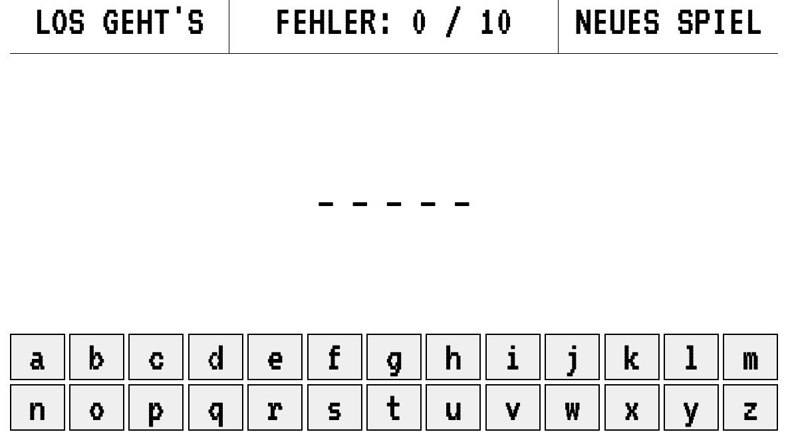
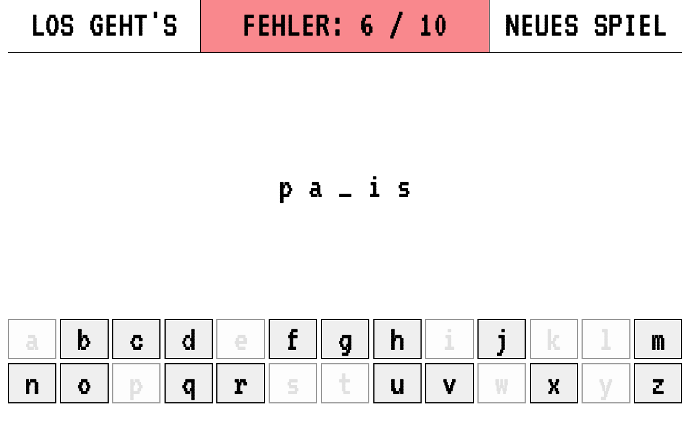

# Hangman – Hauptstädte raten 🌍

**Ein interaktives Worträtsel mit HTML, CSS und JavaScript**

## Über das Projekt

Hangman ist ein kleines browserbasiertes Wort Ratespiel, das ich im Rahmen einer JavaScript-Coding-Kata entwickelt habe.

Ziel des Spiels ist es, eine zufällig ausgewählte Hauptstadt zu erraten, bevor zehn Fehlversuche erreicht werden.

Das Spiel richtet sich besonders an Kinder und Einsteiger und verbindet spielerisches Lernen mit Geografiewissen.

Im Anschluss an die ursprüngliche Umsetzung habe ich die Anwendung überarbeitet und für verschiedene Bildschirmgrößen optimiert.

## Screenshots

### New Game-Ansicht



### Ingame-Ansicht



## Funktionen

- Zufällige Auswahl aus zehn europäischen und internationalen Hauptstädten
- Interaktive Buchstabentastatur mit 26 Buchstaben
- Richtige Buchstaben werden an den entsprechenden Stellen aufgedeckt
- Bereits verwendete Buchstaben werden deaktiviert
- Anzeige der Fehlversuche (maximal zehn)
- Farbige Rückmeldung bei falschen Versuchen
- Gewinn- und Verlustanzeige
- Neues Spiel über einen eigenen Button starten
- Responsives Layout für Smartphones, Tablets und Desktop

## Verwendete Technologien

| Technologie | Verwendung                                            |
| ----------- | ----------------------------------------------------- |
| HTML5       | Struktur und Bedienelemente                           |
| CSS3        | Gestaltung, Animationen und Responsive Design         |
| JavaScript  | Spiellogik, Ereignisverarbeitung und DOM-Manipulation |

Das Projekt wurde ohne JavaScript-Framework umgesetzt.

## Spielregeln

1. Beim Start wird eine Hauptstadt zufällig ausgewählt.
2. Das gesuchte Wort wird zunächst durch Unterstriche dargestellt.
3. Durch Anklicken eines Buchstabens wird geprüft, ob dieser im Wort vorkommt.
4. Bei einem richtigen Buchstaben werden alle entsprechenden Positionen aufgedeckt.
5. Bei einem falschen Buchstaben erhöht sich die Anzahl der Fehlversuche.
6. Das Spiel endet, wenn das Wort vollständig erraten wurde oder zehn Fehlversuche erreicht sind.
7. Mit „Neues Spiel“ beginnt eine neue Runde.

## Lokal starten

Es ist keine Installation und kein zusätzlicher Entwicklungsserver erforderlich.

Repository klonen:

```bash
git clone https://github.com/thomas-brakutt/hangman-kata.git
cd hangman-kata
```

Anschließend die Datei `index.html` im Browser öffnen.

Alternativ kann das Repository als ZIP-Datei heruntergeladen und entpackt werden.

## Projektstruktur

```text
hangman-kata/
├── screenshots/
│   └── hangman.png
├── index.html
├── style.css
├── script.js
└── readme.md
```

## Was ich bei diesem Projekt gelernt habe

- Arbeiten mit Arrays und zufälliger Wortauswahl
- Verarbeitung von Benutzerinteraktionen durch Event-Listener
- Manipulation von HTML-Elementen über JavaScript
- Verwaltung des Spielzustands
- Umsetzung von Gewinn- und Verlustbedingungen
- Responsive Design mit CSS Grid und Media Queries

## Autor

Entwickelt von [Thomas Brakutt](https://github.com/thomas-brakutt) als JavaScript-Lernprojekt und anschließend für das GitHub-Portfolio überarbeitet.
